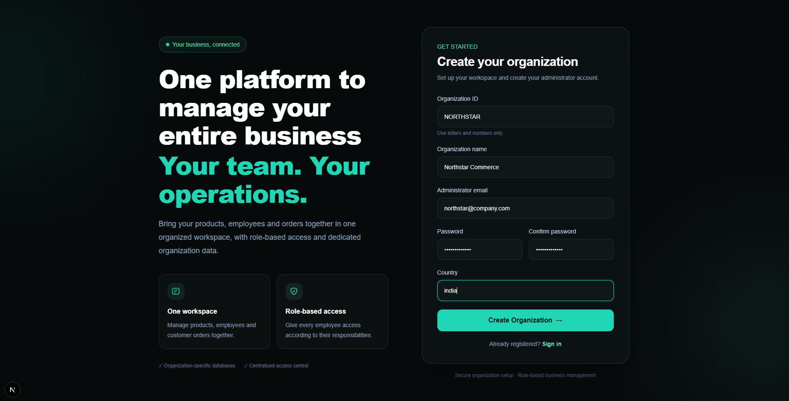
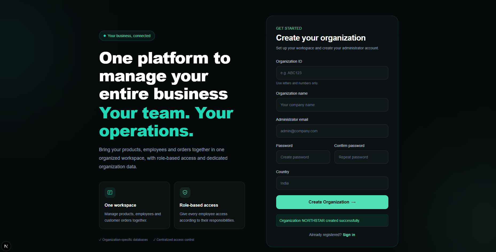
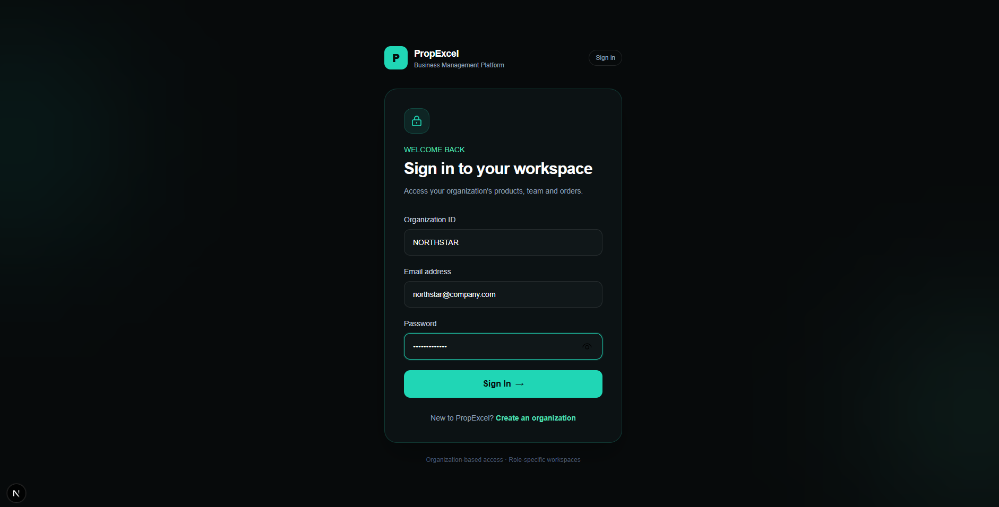
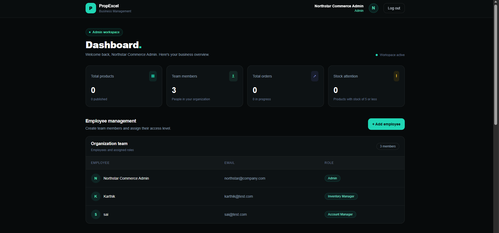
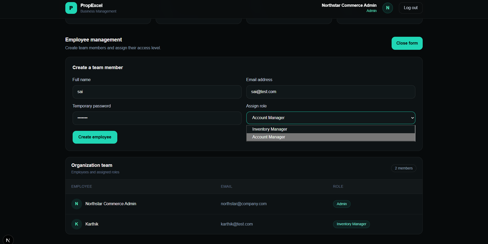
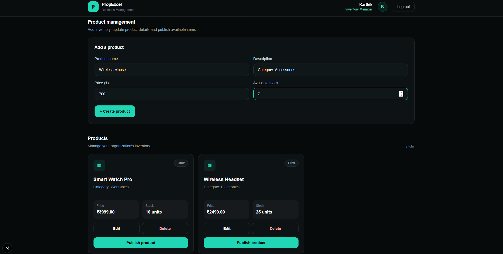
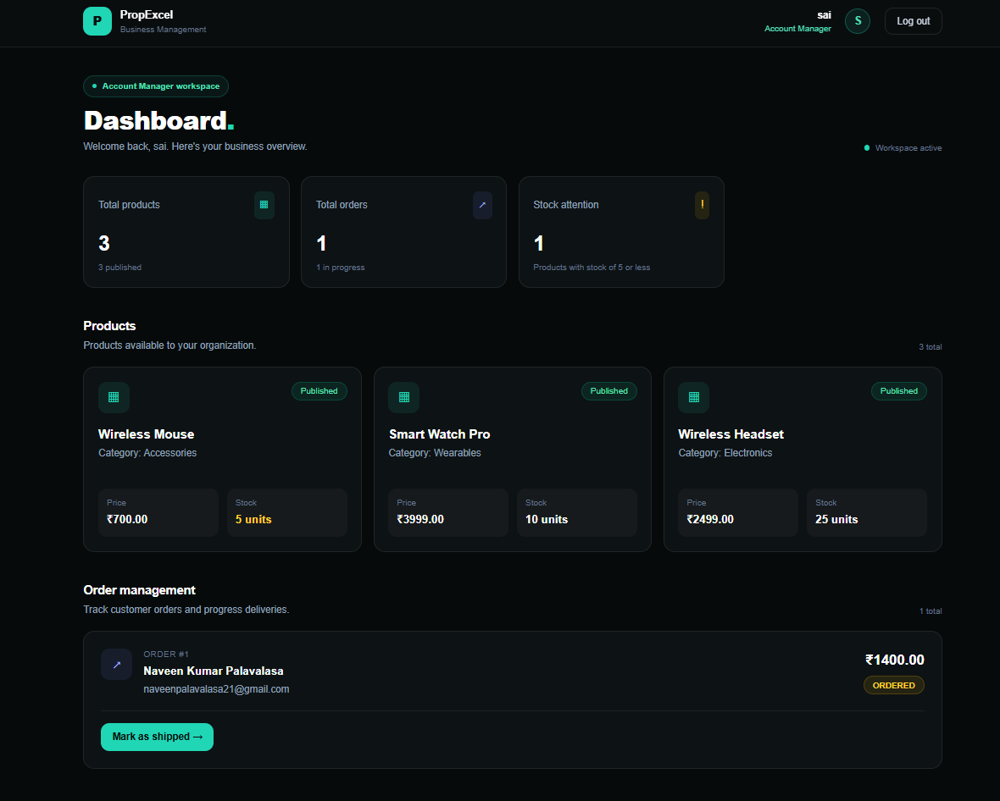
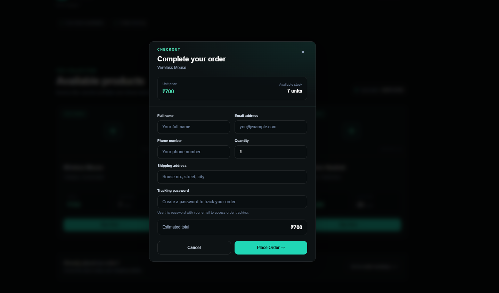
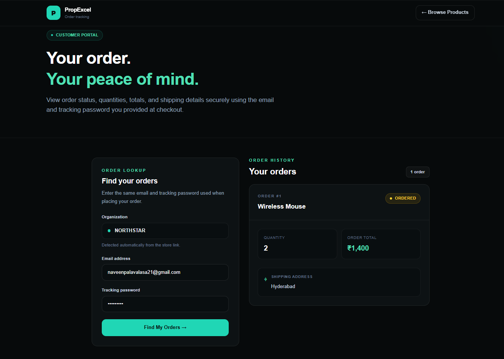

# Company Management System

A multi-tenant business management application for managing organizations, employees, product inventory, and customer orders through role-based access control (RBAC).

The application separates organization data into tenant databases and provides dedicated workflows for administrators, inventory managers, account managers, and customers.

## Table of Contents

- [Overview](#overview)
- [Core Workflows](#core-workflows)
- [Roles and Permissions](#roles-and-permissions)
- [Features](#features)
- [Technology Stack](#technology-stack)
- [Project Structure](#project-structure)
- [Application Screenshots](#application-screenshots)
- [Local Setup](#local-setup)
- [Configuration Notes](#configuration-notes)
- [Security](#security)
- [Author](#author)

## Overview

This project demonstrates a multi-tenant company management system with a web frontend and REST API backend.

Each organization has its own tenant database. A master database stores organization information and helps the backend identify the correct tenant. After authentication, API requests use the user's organization context and role permissions to control access to protected features.

## Core Workflows

### 1. Organization registration

1. A new organization submits the signup form.
2. The backend registers the organization in the master database.
3. A tenant database is created and initialized with the application's required tables, roles, and permissions.
4. The registering user is created as the organization's Admin.
5. The Admin can sign in and manage the organization's employees.

### 2. Authentication and access control

1. A user submits their organization details and login credentials.
2. The backend resolves the organization and verifies the user's password.
3. On successful authentication, the backend issues a JWT.
4. Protected API routes validate the token and check the required permissions before performing an operation.

### 3. Employee management

1. The Admin creates employee accounts.
2. The Admin assigns each employee an appropriate role.
3. The assigned role determines which operations the employee can perform.

### 4. Inventory and product publishing

1. The Inventory Manager creates and maintains products.
2. Product details and stock quantities are stored in the organization's tenant database.
3. Products can be published to the public storefront.
4. The storefront displays products that are published and have available stock.

### 5. Customer checkout and order tracking

1. A customer browses the public storefront.
2. The customer submits an order with the selected products and quantities.
3. The backend creates the order and its order items, and updates inventory as part of the checkout transaction.
4. The Account Manager views orders and updates their status through the order-management workflow.
5. The customer uses the tracking page to check the order's progress.

## Roles and Permissions

| Role | Main responsibilities |
|---|---|
| **Admin** | Manage employee accounts and assign roles |
| **Inventory Manager** | Create, view, update, delete, and publish products, subject to permissions and business rules |
| **Account Manager** | View orders and update order statuses |
| **Customer** | Browse available products, place orders, and track orders |

Access control is enforced by the backend; hiding a frontend control alone is not treated as authorization.

## Features

- Organization registration and tenant initialization
- Organization-to-tenant mapping through a master database
- JWT-based authentication
- Password hashing with bcrypt
- Role-based access control (RBAC)
- Employee and role management
- Product CRUD operations
- Product publishing and stock availability checks
- Public storefront
- Order and order-item creation
- Inventory updates during checkout
- Order status management
- Customer order tracking

## Technology Stack

- **Frontend:** React / Next.js
- **Backend:** Node.js and Express.js
- **Database:** PostgreSQL, hosted on Neon
- **Authentication:** JSON Web Tokens (JWT)
- **Password hashing:** bcrypt
- **API style:** REST

## Project Structure

```text
company-project/
├── backend/
│   ├── src/
│   │   ├── middleware/
│   │   │   ├── auth.js
│   │   │   └── authorize.js
│   │   ├── routes/
│   │   │   ├── auth.js
│   │   │   ├── orders.js
│   │   │   ├── products.js
│   │   │   ├── public.js
│   │   │   └── users.js
│   │   ├── app.js
│   │   ├── db.js
│   │   ├── server.js
│   │   └── tenant.js
│   ├── .env.example
│   ├── package.json
│   └── README.md
├── frontend/
├── screenshots/
│   ├── admin_dashboard.png
│   ├── admin_dashboard1.png
│   ├── signin.png
│   ├── signup.png
│   ├── signup_demo.png
│   ├── customer_booking.png
│   ├── order_track.png
│   ├── Inventory_manager.png
│   └── account_manager.png
├── .gitignore
└── README.md
```

## Application Screenshots

The images below are expected to be stored in the root-level `screenshots/` directory. The paths are case-sensitive on GitHub, so keep the filenames exactly as shown.

### Organization signup demo



### Signup page



### Sign-in page



### Admin dashboard



### Admin dashboard — alternate view



### Inventory Manager



### Account Manager



### Customer booking and storefront



### Order tracking



## Local Setup

### Prerequisites

- Node.js and npm
- A PostgreSQL database (for example, Neon)
- Git

### 1. Clone the repository

```bash
git clone <YOUR_GITHUB_REPOSITORY_URL>
cd company-project
```

Replace `<YOUR_GITHUB_REPOSITORY_URL>` with your repository's HTTPS URL.

### 2. Configure and start the backend

```bash
cd backend
npm install
```

Create `backend/.env` based on `backend/.env.example` and provide the required configuration values for your environment. Do not commit the real `.env` file.

Initialize the master database and its required tables as expected by the application. The database connection settings must point to your own PostgreSQL instance.

Start the backend:

```bash
npm start
```

The backend is expected to listen at `http://localhost:5000`.

### 3. Configure and start the frontend

Open a second terminal at the project root and run:

```bash
cd frontend
npm install
npm run dev
```

Open `http://localhost:3000` in your browser.

If the frontend requires environment variables, configure them according to the frontend's own setup and source code.

## Configuration Notes

- Keep the master database connection string and any JWT secret in environment variables.
- Configure the database role and permissions required to create tenant databases, if tenant database creation is part of the signup flow.
- Use `.env.example` as a reference only; never put real credentials in it.
- Setup details can vary by development environment. Review the backend and frontend configuration before running the application on a new machine.

## Security

- Never commit `.env` files, database credentials, JWT secrets, or other sensitive values.
- Passwords should be stored as hashes, not plaintext.
- Keep authentication and permission checks on the backend for protected operations.
- Use organization/tenant context to scope access to organization data.

## Author

**Naveen Kumar Palavalasa**

B.Tech — Electronics and Communication Engineering
